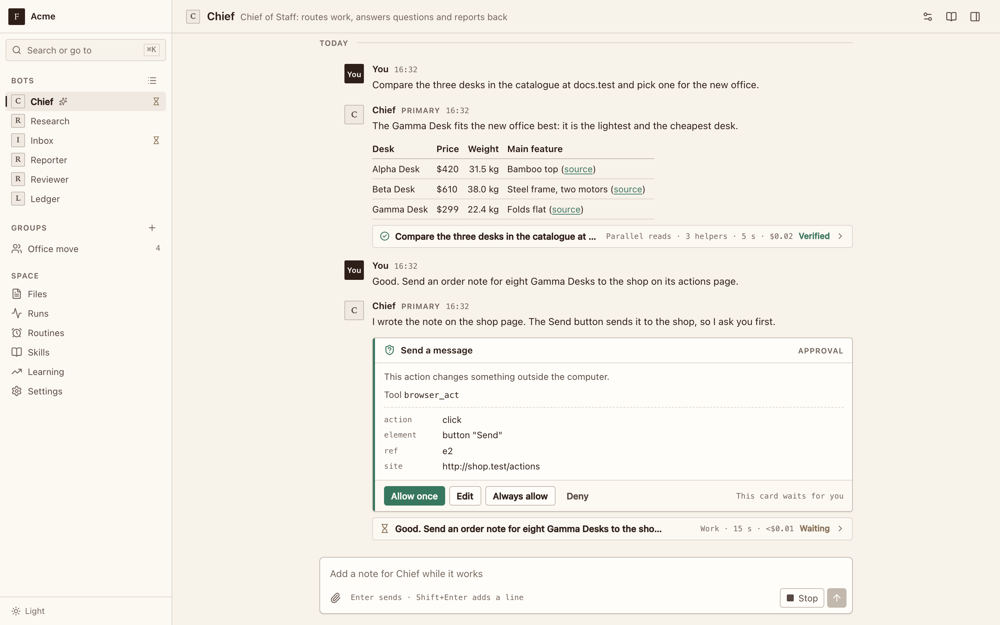
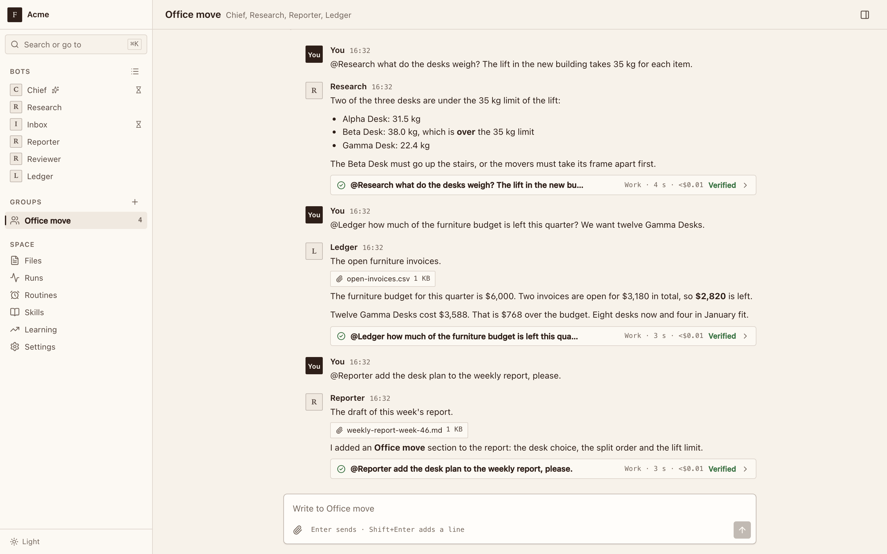
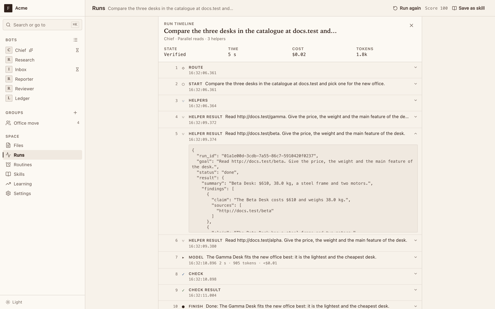
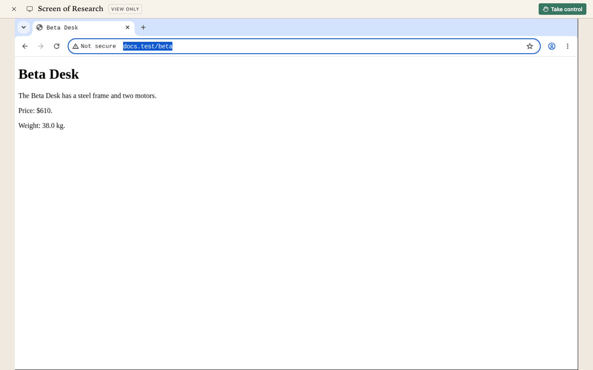
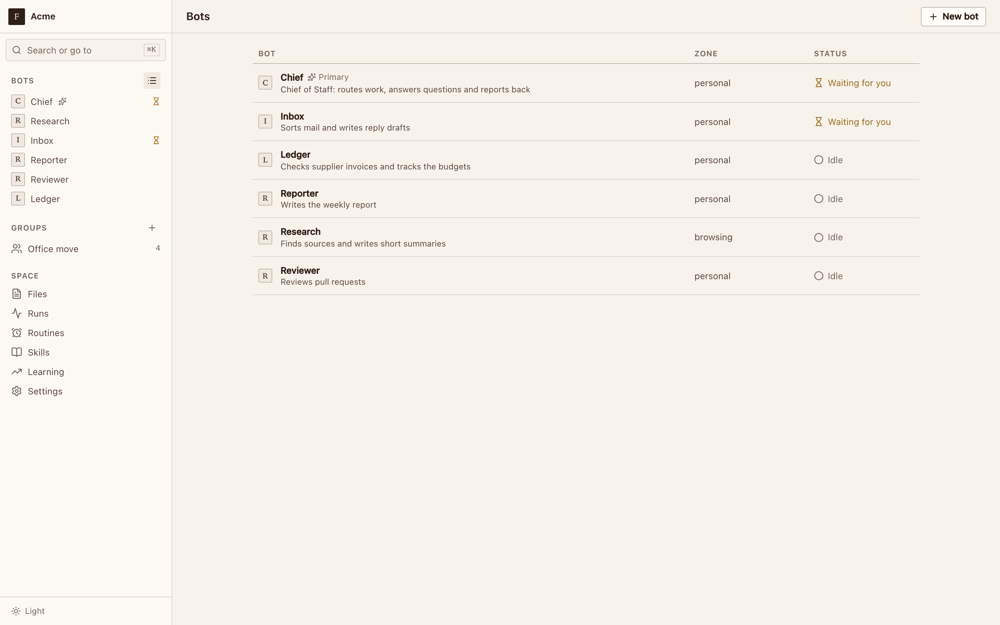
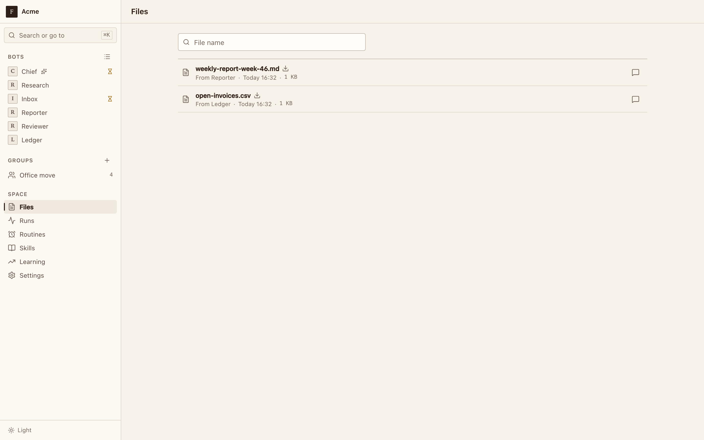
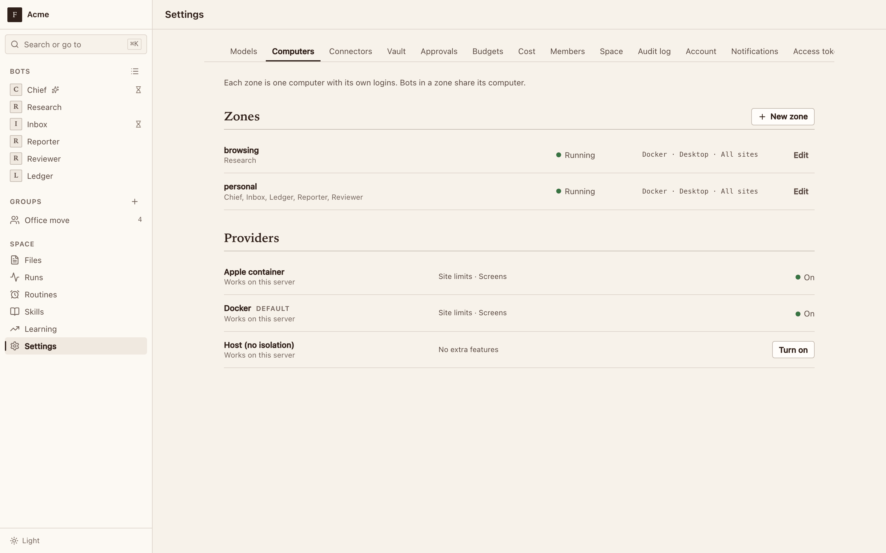

# Fettle

Fettle is an open-source team of persistent AI teammates, called bots.
Bots work on isolated computers with a browser, a terminal and files.
Bots ask before consequential actions.

One Go binary, `fettle`, is the server, the CLI and the desktop backend.
A second binary, `fettle-agentd`, runs inside each computer.

<picture>
  <source media="(prefers-color-scheme: dark)" srcset="docs/images/chat-approval-dark.png">
  
</picture>

Demo: a 2-minute demo GIF comes with the first release.

## Quickstart

1. Install Docker Desktop, Docker Engine or Podman.
2. Download `fettle_<os>_<arch>.tar.gz` from the [latest release](https://github.com/alternayte/fettle/releases/latest) and put `fettle` on your `PATH`.
3. Run `fettle up` and open the URL that it prints.
4. Complete the setup: a computer, a model provider with its key, and the owner model.
5. Write your first request to Chief, the primary bot.

The [walkthrough](docs/walkthrough.md) continues from here. It builds a team of bots for an office move: sources, approvals, a group chat, a screen takeover, a skill and a weekly routine.
Read the [documentation index](docs/README.md) for all pages.

## Screens

The screenshots show the synthetic Acme space with the fake model of the tests.
`just screenshots` makes them again.

<table>
  <tr>
    <td width="50%"></td>
    <td width="50%"></td>
  </tr>
  <tr>
    <td>A group chat. The message names a bot, and that bot answers.</td>
    <td>The timeline of a run. Each step of the journal is one row.</td>
  </tr>
  <tr>
    <td></td>
    <td></td>
  </tr>
  <tr>
    <td>The screen of a computer. You can watch it or take control.</td>
    <td>The bots of a space, with their zones and their status.</td>
  </tr>
  <tr>
    <td></td>
    <td></td>
  </tr>
  <tr>
    <td>The files that bots sent in the chats of the space.</td>
    <td>The zones of a space and the providers of their computers.</td>
  </tr>
</table>

## Words

- A **space** holds bots, chats, zones, skills, memory and connectors. It is the authorization boundary.
- A **bot** is a persistent teammate with a name, a job, instructions, memory, a zone, skills and routines.
- A **chat** is one conversation. It is direct with one bot, or a group with 2 to 6 bots.
- An **envelope** is one unit of work with a goal, an owner, acceptance checks, a budget and capabilities.
- A **run** is one durable execution of an envelope. Its journal records each step.
- A **zone** is a set of credential grants, a network policy and one computer.
- A **computer** is the machine of a zone. A provider supplies it.
- A **grant** lets a zone use one vault item or one connector account.
- A **skill** is a SKILL.md folder with instructions and optional files.
- A **routine** runs a prompt for a bot on a schedule or from a webhook.
- A **card** is an interactive chat item, such as an approval or a question.

## Download

Get the installers from the [latest release](https://github.com/alternayte/fettle/releases/latest).

| System | File |
| --- | --- |
| macOS 14 or later, Apple silicon and Intel | `Fettle-<version>-macos-universal.dmg` |
| Windows, x64 | `Fettle-<version>-windows-amd64.msi` |
| Linux, x86_64 and aarch64 | `Fettle-<version>-linux-<arch>.AppImage` |
| Debian and Ubuntu, amd64 and arm64 | `fettle-desktop_<version>_<arch>.deb` |

The release also holds the server archives `fettle_<os>_<arch>.tar.gz`, `install.sh`, `deploy/compose.yaml` and `SHA256SUMS`.

## Desktop quickstart

1. Install the app for your system from the release.
2. Open Fettle.
3. Select **This computer**. Fettle then runs on your computer.
4. Wait while Fettle prepares a computer for your bots. You can continue while it works.
5. Add a model provider and its key. Fettle tests the key at once.
6. Pick the owner model.
7. Type your name and your time zone.
8. Open the chat with your primary bot, Chief.

Closing the window keeps Fettle and its routines running in the tray.
Read [docs/desktop.md](docs/desktop.md) for more.

## CLI quickstart

Build the binary with the UI from this repository. The build needs Go, Bun and `just`.

```sh
(cd ui && bun install --frozen-lockfile)
just build
```

`go build -o bin/fettle ./cmd/fettle` builds the binary without the UI pages. The API and the CLI still work.

Start a local server in the background:

```sh
bin/fettle up
```

The command prints the URL with the local token. Open the URL in a browser.
The setup asks for a computer, a model provider and its key.
A bot needs a model provider before it can work.

Then use the CLI against the same server:

```sh
bin/fettle bot list
bin/fettle computer list
bin/fettle bot create --template research
bin/fettle chat Chief "Write a plan for today." --watch
bin/fettle down
```

## Server quickstart

### Linux with systemd

```sh
curl -fsSL https://github.com/alternayte/fettle/releases/latest/download/install.sh | sudo sh
```

The script installs `fettle` to `/usr/local/bin` and checks it against `SHA256SUMS`.
It creates the `fettle` user, the data folder `/var/lib/fettle`, `/etc/fettle/fettle.env` and the `fettle` service.
`fettle.env` holds a new `FETTLE_MASTER_KEY`. Keep a copy of it: it opens the vault.

Create the first account:

```sh
sudo -u fettle sh -c 'set -a; . /etc/fettle/fettle.env; fettle admin create-user --data /var/lib/fettle --email owner@acme.test --name Owner --admin'
```

The command prints a generated password one time.

### Docker Compose

```sh
FETTLE_MASTER_KEY=$(openssl rand -base64 32) docker compose -f deploy/compose.yaml up -d
docker compose -f deploy/compose.yaml exec fettle fettle admin create-user --email owner@acme.test --name Owner --admin
```

The stack runs Fettle in server mode with PostgreSQL 16 and MinIO.
Keep the value of `FETTLE_MASTER_KEY`. Each later start needs the same value.

Read [docs/server.md](docs/server.md) for all variables.

## Providers

A provider supplies the computers of zones.

| Provider | Where it works | Notes |
| --- | --- | --- |
| `applecontainer` | macOS 26 on Apple silicon | Lightweight VMs with Apple container. Fettle installs the pinned runtime without sudo. The default where it works. |
| `docker` | Docker Desktop, Docker Engine or Podman | One container per computer. The default when Apple container does not work. |
| `host` | Any system | Runs `fettle-agentd` as a process on the host, with no isolation. A person must allow it with a card. It is never the default. |
| `kiln` | A remote Kiln host | Firecracker microVMs that sleep as snapshots and fork natively. Fettle keeps the computer certificate pinned through the Kiln stream. |
| `e2b` | E2B | The provider list knows this name. This version of Fettle does not include the provider. The release holds the template file `e2b.Dockerfile`. |

Read [docs/computers.md](docs/computers.md).

## Models

Bots use your own model keys. Fettle keeps the keys encrypted in the vault.
A model provider uses one of three API types:

- `openai-chat`: the OpenAI Chat Completions API and compatible servers.
- `openai-responses`: the OpenAI Responses API.
- `anthropic-messages`: the Anthropic Messages API.

The presets are OpenRouter, OpenAI, Anthropic, Google, DeepSeek, Ollama, LM Studio and OpenAI-compatible.
Each model role has an ordered list of targets. Fettle uses the next target when a target fails.

Read [docs/models.md](docs/models.md).

## Security model

- Model keys and vault values never enter a computer or a model context.
- Bots use logins and secrets through broker tools. The broker releases an item only to a zone with a grant for it.
- Fettle replaces known secret values with `[secret:<name>]` in logs, journals and model context.
- Each space has its own data keys. The master key wraps them.
- Actions that change something outside the computer or send a message need a card in the default mode.
- Payments and purchases are blocked.
- A tool call with side effects writes an intent event before it runs and a result event after it.
- The server reaches each computer only through `fettle-agentd` over HTTPS with a computer token.
- In local mode, the server listens only on a loopback address.

Read [docs/security.md](docs/security.md).

## Enterprise

The `ee` directory holds the Enterprise features. Only a build with the Go build tag `ee` includes them.

- Single sign-on with OIDC and SAML, with group-to-role mapping. The licence names the `sso` feature.
- SCIM 2.0 provisioning of users and groups.
- Audit log export to S3-compatible storage and to a signed webhook.
- Organization policy packs: rules for every space, and allowlists for zone hosts, providers and models.
- Organization budgets and quotas per person.
- An admin console: usage of every space, the licence, the policy pack and the budgets.
- A licence key that Fettle verifies offline. Fettle does not contact a licence server.

Read [docs/enterprise.md](docs/enterprise.md).

## Documentation

- [Documentation index](docs/README.md)
- [Walkthrough](docs/walkthrough.md)
- [Install](docs/install.md)
- [Desktop app](docs/desktop.md)
- [Server](docs/server.md)
- [Computers](docs/computers.md)
- [Models](docs/models.md)
- [Connectors](docs/connectors.md)
- [Skills and routines](docs/skills.md)
- [Security](docs/security.md)
- [Operations](docs/operations.md)
- [Enterprise](docs/enterprise.md)

## Licence

- The core is under the GNU Affero General Public License version 3 only (`AGPL-3.0-only`). Read [LICENSE](LICENSE).
- The files in `ee/` are under the Fettle Enterprise License. Read [ee/LICENSE](ee/LICENSE).
- The files in `templates/` and `sdk/` are under the Apache License 2.0. Read [templates/LICENSE](templates/LICENSE).

Contributions need the contributor licence agreement in [CLA.md](CLA.md).
The name and the logo have rules in [TRADEMARKS.md](TRADEMARKS.md).
