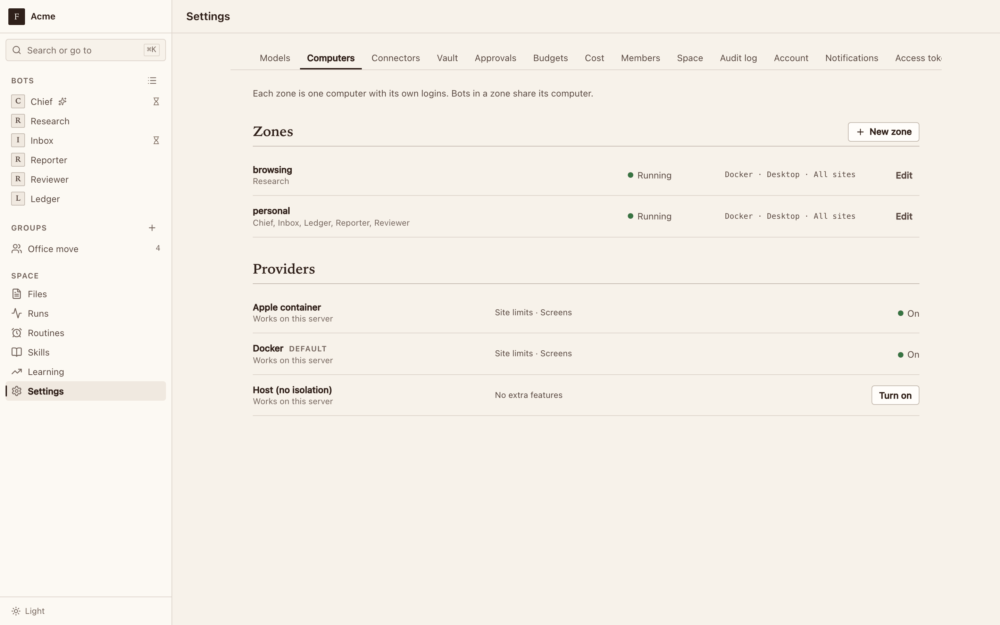
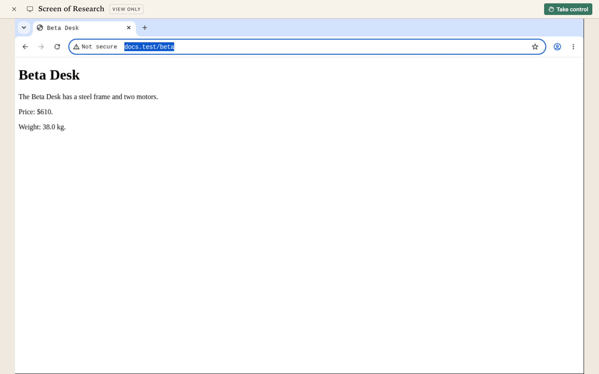

# Computers

Each zone has one computer. Bots in a zone share its computer.
A computer has a shell, files, Python, Node and, from the `browser` size, a browser.
The server reaches each computer only through `fettle-agentd` over HTTPS with a computer token.

## Zones

A new space has two zones: `personal` and `browsing`.
A zone has these settings:

| Setting | Values |
| --- | --- |
| Provider | A provider kind, or the default provider. |
| Size | `small`, `browser` or `desktop`. |
| Network | `open` reaches all sites. `allowlist` reaches only the listed hosts. |
| Sleep after | Minutes without work before the computer sleeps, from 1 to 1440. |

A bot asks for a new zone with a card. The zone exists after a person allows the card.
A change of the provider or the network replaces the computer of the zone.

Each bot works in one zone. You choose the zone in the **New bot** form. A template suggests its own zone.
To move a bot, open its settings page and use **Computer**. An owner can move a bot when it has no work in progress. The bot uses the new computer from its next run, and its own files go with it.

Settings > Computers lists the zones and the providers.
The menu at the end of a zone row tests the computer (it starts the computer and runs one command) and puts a running computer to sleep. A sleeping computer keeps its files, and the next work wakes it.



## Sizes

| Size | CPU | Memory | Disk | Contents |
| --- | --- | --- | --- | --- |
| `small` | 1 | 1 GiB | 10 GiB | Shell, files, Python and Node. |
| `browser` | 2 | 2 GiB | 10 GiB | Adds a browser. |
| `desktop` | 2 | 3 GiB | 10 GiB | Adds screens that you can take over. |

## Providers

| Provider | Where it works | Site allowlist | Screens |
| --- | --- | --- | --- |
| `applecontainer` | macOS 26 on Apple silicon | yes | yes |
| `docker` | Docker Desktop, Docker Engine or Podman | yes | yes |
| `host` | any system | no | no |
| `kiln` (remote) | a Kiln host, with its URL and token | yes | yes |
| `e2b` | E2B | | |

### applecontainer

The provider runs each computer as a lightweight VM with Apple container 1.x.
It works on macOS 26 on Apple silicon.
When the runtime is missing, Fettle downloads the pinned package and checks its checksum and its Apple signature.
Fettle installs the runtime into the data folder. No step needs sudo.
It is the default provider where it works.

### docker

The provider runs one container per computer through the Docker Engine API.
It connects to the engine from `DOCKER_HOST` or the default socket.
It works with Docker Desktop, Docker Engine and Podman.
It is the default provider when `applecontainer` does not work.

### host

The provider runs `fettle-agentd` as a child process of Fettle, with a home folder under the data folder.
It has no isolation. Bots run commands with the rights of the user that runs Fettle.
It cannot limit sites, so a zone with an allowlist cannot use it.
Turning it on is a hard ask: a card asks a person in every approval mode.
It is never the default provider.
Fettle looks for `fettle-agentd` next to the `fettle` binary. `FETTLE_AGENTD_BIN` names another path.

### kiln

The provider runs each computer as a Firecracker microVM on a remote Kiln host.
A computer sleeps as a snapshot and wakes from it with its memory and disk.
A fork is a native copy of the running computer.

Fettle reaches `fettle-agentd` through a Kiln port stream.
Fettle runs its own TLS inside the stream and checks the pinned certificate of the computer.
The Kiln host does not see the requests to `fettle-agentd`.

To use a Kiln host:

1. Test the host and the token: `fettle computer add kiln --url https://kiln.acme.test --token <token>`.
2. Set `FETTLE_KILN_URL` and `FETTLE_KILN_TOKEN` for the server, and restart it.
3. Build the computer templates: `fettle computer add kiln`.
4. Select `kiln` as the provider of a zone.

A zone with an allowlist gets the same hosts on the Kiln host and in the computer.
An open zone lets the computer reach every host name on ports 80 and 443.
`kiln` is never the default provider, except when `FETTLE_DEFAULT_PROVIDER` names it.
This version runs Kiln only as a remote host. A local Kiln on the same computer is not in this version.

### e2b

The provider list knows the name `e2b`.
This version of Fettle does not include the provider.
`fettle computer add e2b` reports this.
The release holds `e2b.Dockerfile`, the E2B template definition of the computer image.

### Default provider

Fettle picks the default provider at start: `applecontainer` where it works, else `docker`.
`FETTLE_DEFAULT_PROVIDER` sets another default.

## The computer image

Every provider except `host` runs the computer image.
The image is Debian slim with the non-root user `fettle`.
It holds Chromium, Xvfb, x11vnc, git, ripgrep, curl, jq, Python 3 with uv, Node 22, pdftotext, pandoc and `fettle-agentd`.
The image has no `sudo` and no `su`.

| Build | Image |
| --- | --- |
| A release | `ghcr.io/alternayte/fettle-computer:<version>` |
| A development build | `fettle-computer:dev`, from `just image` |

`FETTLE_COMPUTER_IMAGE` sets another image.

## CLI

```sh
fettle computer list
fettle computer add docker
fettle computer test
fettle computer test browsing
fettle computer stop personal
```

- `computer list` shows the zones with their provider, state, size, network and bots. Then it shows the providers.
- `computer add <docker|applecontainer|host>` turns on a provider and prepares it. For `host`, a card in the chat of the primary bot asks you to allow it.
- `computer test [zone]` starts the computer of a zone and runs one command in it. The default zone is `personal`.
- `computer stop <zone>` puts the computer of a zone to sleep. Its workspace stays.

## Sleep and limits

A computer sleeps after its idle time. The next work wakes it.
The instance setting `computers.max_running` limits the computers that run at the same time.
With 0, local mode uses a value from the memory of the host: 1 computer per 2 GiB above 4 GiB, at least 1.
The space setting `workspaces.home_limit_gib` limits the size of one bot home. The default is 5 GiB.

## Screens

A computer of the `desktop` size has a screen.
You can open the screen of a bot read-only from the chat header of the bot, from the **Computer** section of its settings page, or from the zone row in Settings > Computers.
You can take control of the screen for 15 minutes at a time. The bot waits while you control it.


