# Walkthrough: a team for an office move

This tutorial builds one Fettle space from the first start to a team of bots that works together.
The example company is Acme. Acme moves to a new office and needs desks.

You do these steps:

1. Install Fettle and start it.
2. Complete the setup: a computer, a model provider and the owner model.
3. Ask Chief, the primary bot, for a desk comparison with sources.
4. Approve an action that changes something outside the computer.
5. Add bots and start a group chat.
6. Take control of the screen of a bot.
7. Save a run as a skill and give it to bots.
8. Turn on a weekly report routine.
9. Examine runs, cost and Learning.

The screenshots come from `just screenshots`. They show the synthetic Acme space with the fake model of the tests.
The sites `docs.test` and `shop.test` are test sites of the screenshots. Use your own sites in your space.
The screenshots show the space at the end of the tutorial, so the sidebar lists all bots from the start.

## Before you start

You need:

- Docker Desktop, Docker Engine or Podman. On macOS 26 on Apple silicon, Fettle can use Apple container instead.
- A key for a model provider, or a local model server such as Ollama or LM Studio. The model must support tool calls.

## 1. Install and start Fettle

1. Download `fettle_<os>_<arch>.tar.gz` from the [latest release](https://github.com/alternayte/fettle/releases/latest).
2. Extract the archive and put `fettle` on your `PATH`.
3. Start a local server in the background:

   ```sh
   fettle up
   ```

4. Open the URL that the command prints. The URL holds the local token that signs you in.

The setup opens in the browser.

The server listens only on a loopback address in local mode. The same binary is the server and the CLI, so the CLI commands in this tutorial use the same server.
To use the desktop app instead, read [desktop.md](desktop.md). The desktop app adds a **Where** step before the steps below.

## 2. Prepare a computer

The **Computer** step finds a way to run computers on this host and prepares one.

1. Read the preparation list. Fettle checks the container runtime and gets the computer image.
2. Select **Continue**. You do not have to wait for the preparation.

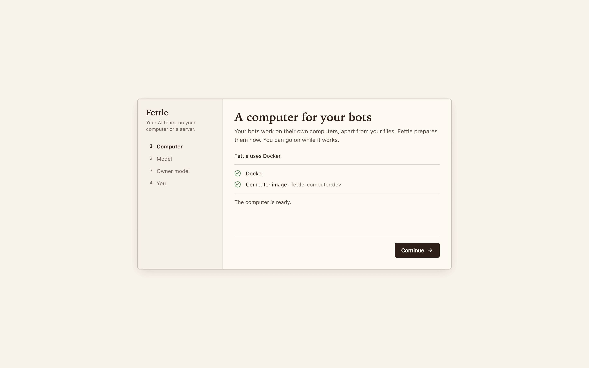

Bots work on their own computers, apart from your files. Each computer has a browser, a terminal and files.
If Fettle finds no way to run computers, bots can chat but cannot use a browser, a terminal or files. Read [computers.md](computers.md).

## 3. Add a model provider

1. In **Provider**, select a preset, for example **OpenRouter**, **Anthropic** or **OpenAI-compatible**. The preset fills the base URL and the API type.
2. Type the key of the provider.
3. Optional: select **More options** and type a name for the provider.
4. Select **Save and test**.
5. Read the four checks: plain answer, tool call round trip, structured output and image input.
6. Select **Continue** when the tool call check passes.

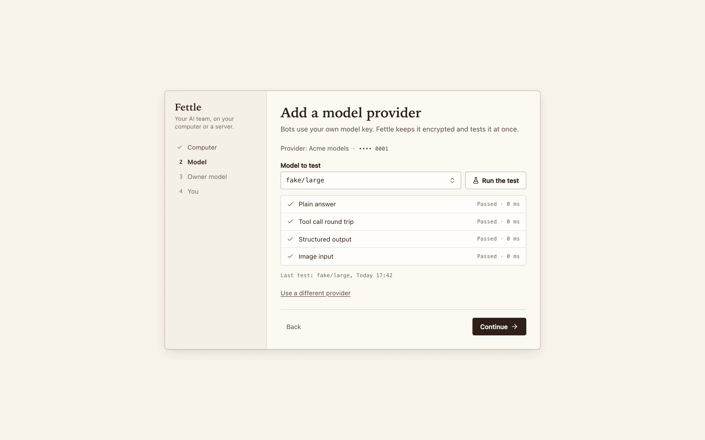

Fettle keeps the key encrypted in the vault. The key never enters a computer or a model context.
Bots need tool calls, so a provider that fails the tool call check cannot do the work of a run. Read [models.md](models.md).

## 4. Pick the owner model

1. Select the **Owner model** field. A searchable list of the models of the provider opens.
2. Type a part of the model name to filter the list.
3. Select a model. If the list does not have the model, type its full name and select **Use**.
4. Select **Continue**.
5. Type your name and your time zone, then select **Open the chat**.

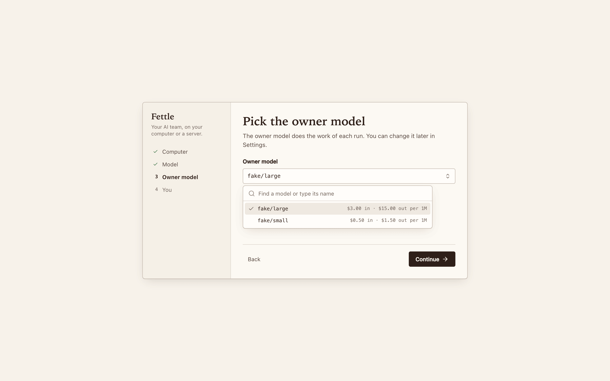

The owner model does the work of each run. Other roles, such as the router and the verifier, use the owner model until you give them their own models in **Settings**, **Models**.

## 5. Meet Chief

The chat with Chief opens. Chief is the primary bot of the space.
Chief answers messages that name no bot, routes work and proposes new bots.
Chief starts with a short interview about your work. Answer it, or write your first request.

## 6. Ask for a desk comparison

1. In the chat with Chief, type a request that needs several sources. This example uses a catalogue with three desk pages:

   > Compare the three desks in the catalogue at docs.test and pick one for the new office.

2. Press Enter.
3. Watch the run line under the reply. It shows the step, the helpers, the time, the cost and the state.
4. Select the run line to open the run in the side panel.

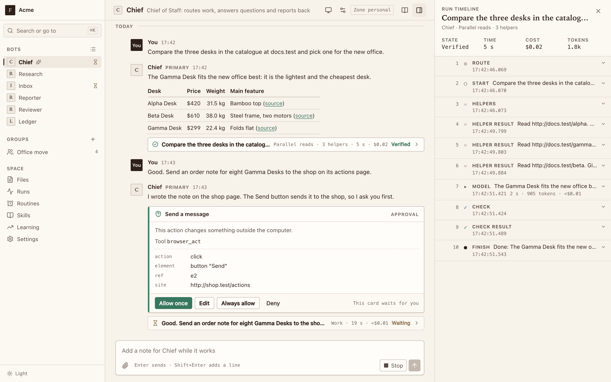

The router picks a step for each piece of work. Here it picks **Parallel reads**: three helpers read one page each at the same time.
Each fact in the answer links to its source. The verifier checks the result against the acceptance checks, and the run line shows **Verified**.

## 7. Read the run timeline

1. Select **Runs** in the sidebar.
2. Select the run of the desk comparison.
3. Select a row of the timeline to see its data. A **Helper result** row shows the findings and the sources of one helper.

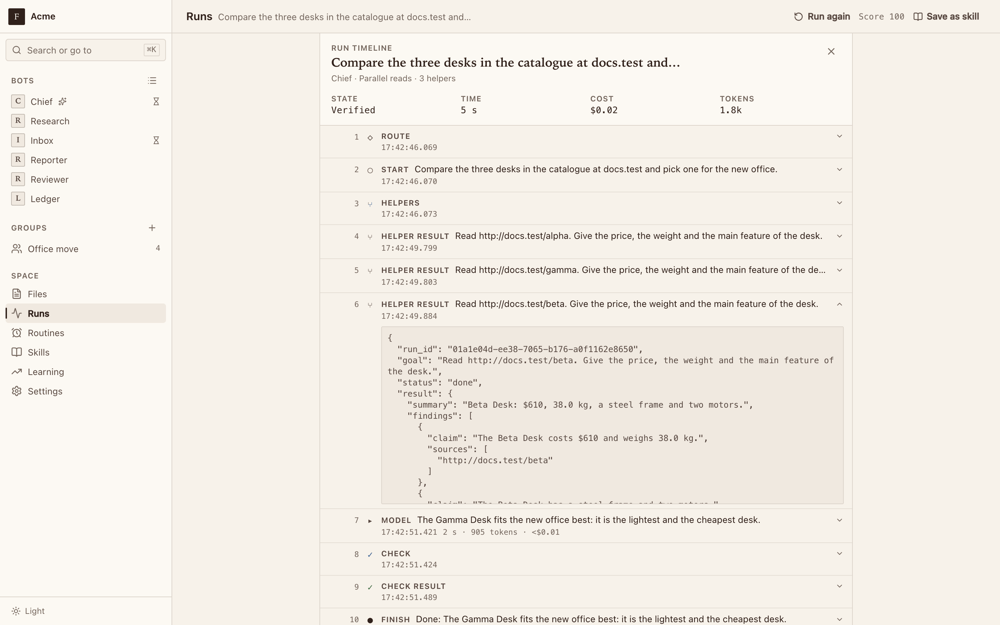

The timeline is the journal of the run. Each step of the run is one row, in order.
Fettle keeps the journal after a restart, so a run continues from its last step.

## 8. Approve an action

1. In the chat with Chief, ask for an action outside the computer:

   > Good. Send an order note for eight Gamma Desks to the shop on its actions page.

2. Read the approval card. It shows the tool, the action, the element and the site.
3. Select one of the buttons:
   - **Allow once** lets this action run one time.
   - **Edit** lets you change the values of the action before it runs.
   - **Always allow** makes an allow rule for actions like this one.
   - **Deny** stops the action.


A click on a button with the name Send is a `send` action. In the default `ask` mode, a bot asks before each change outside its computer and each message that it sends.
Payments and purchases are blocked. Read [security.md](security.md#approvals).

## 9. Add bots

Fettle has five bot templates. Each template has a skill and a paused routine.

1. Select **Bots** in the sidebar, then select **New bot**.
2. Under **Start from**, select **Research**. The form shows the skill and the routine that come with it.
3. In **Zone**, keep `browsing`. The template suggests this zone. A zone is the computer that the bot works on.
4. Select **Create Research**. The settings page of the bot opens.
5. Do steps 1 to 4 again for **Reporter** and **Inbox**. The screenshots also show Reviewer, from the template **Reviewer**. This tutorial does not use it.

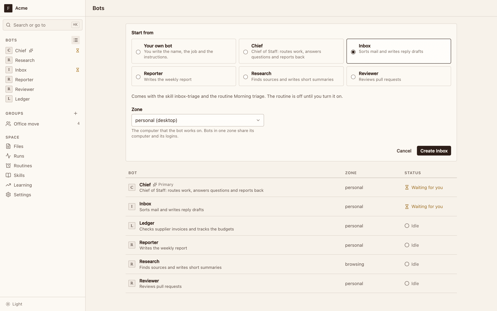

You can also add bots from the CLI with `fettle bot create --template research`.

6. Add a bot without a template. Select **New bot**, then select **Your own bot**.
7. Type the name `Ledger` and the job `Checks supplier invoices and tracks the budgets`. Keep the zone `personal`.
8. Select **Create bot**. The settings page of the bot opens.
9. In **Public description**, type what other bots must know about Ledger. Select **Save**.
10. In **Instructions**, type the rules of the bot. Select **Save as new version**.

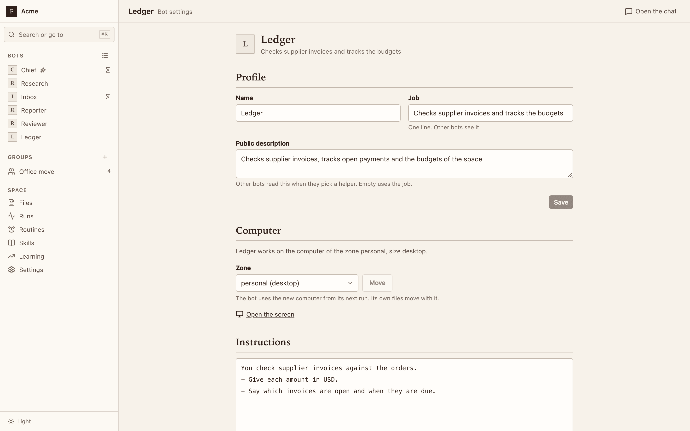

Each save of the instructions makes a new version. **Version history** shows the versions and restores an earlier one.

A bot uses the models of the space. To give one bot other models, open its settings page and go to **Models**. Pick a model for a role, then select **Use for this bot**. Select **Use the space models** to remove the change.
To move a bot to another zone, open its settings page. In **Computer**, choose the zone and select **Move**. The bot uses the new computer from its next run. Fettle does not move a bot while it has work in progress.

The **Bots** page lists the bots with their zones and their status.

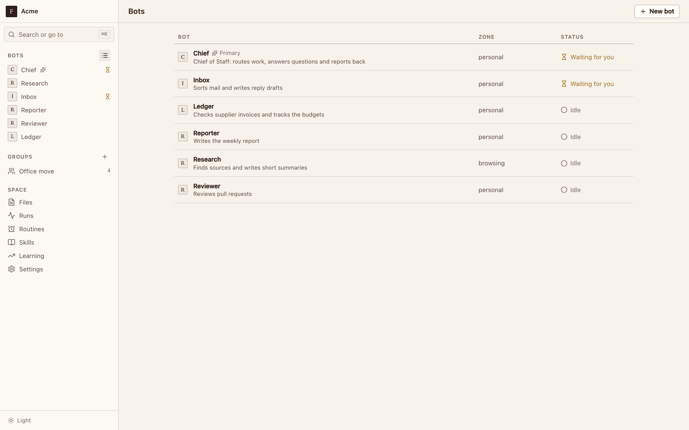

## 10. Start a group chat

1. In the sidebar, select **+** next to **Groups**.
2. Type the group name `Office move`.
3. Select 2 to 6 bots. This example uses Chief, Ledger, Reporter and Research.
4. Select **Create group**.

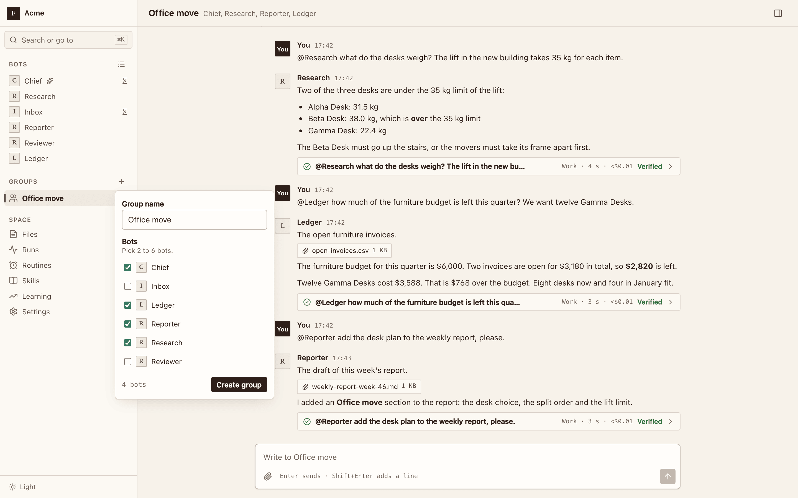

5. Write a message that names one bot with `@`:

   > @Research what do the desks weigh? The lift in the new building takes 35 kg for each item.

6. Ask the next bot in the same way:

   > @Ledger how much of the furniture budget is left this quarter? We want twelve Gamma Desks.

   > @Reporter add the desk plan to the weekly report, please.

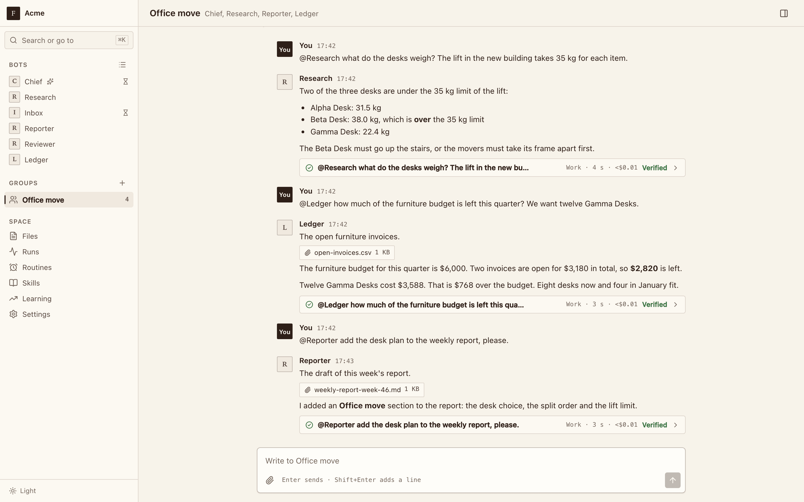

The bot that the message names answers. Without a name, the bot whose job fits best answers.
Files that bots attach show in the chat and on the **Files** page.

## 11. Take control of a screen

Sometimes a bot needs a person, for example to sign in. The bot then asks you to take over its screen.
This needs a zone of the `desktop` size. Read [computers.md](computers.md#sizes).

1. Ask Research for a page that needs a sign-in:

   > Check the delivery dates on the account page of the shop.

2. Read the card **Take over the screen**. It gives the reason of the bot.
3. Select **Open the screen**. The screen of the computer of Research opens. It is view only.

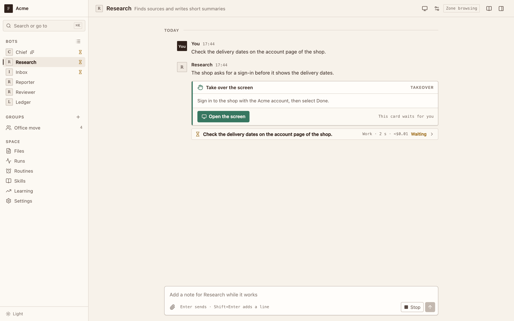

4. Select **Take control**. The status changes to **You control the screen**.
5. Do the work on the screen, for example sign in.
6. Optional: in **Note for the bot**, type what you did.
7. Select **Done**. The bot gets the screen and your note back, and the run continues.

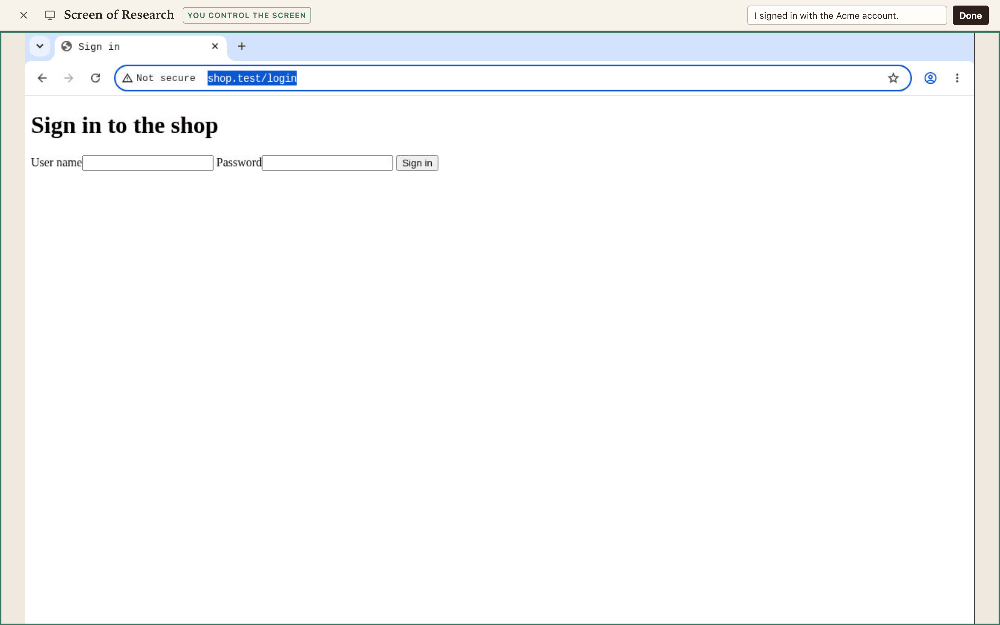

The bot waits while you control the screen. Control lasts 15 minutes at a time.

You can also open a screen without a card, to watch a bot work:

- In the chat of the bot, select the screen button in the header.
- On the settings page of the bot, select **Open the screen** under **Computer**.
- In **Settings**, **Computers**, select **Screen** on the row of a desktop zone.

## 12. Save a run as a skill

A skill is a `SKILL.md` folder with instructions. A bot with a skill sees its name and description, and loads the full skill when the work needs it.

1. Open the run of the desk comparison from **Runs**.
2. Select **Save as skill**. Fettle writes a draft `SKILL.md` from the goal, the steps and the result of the run.
3. Change the name, the description and the steps of the draft. The name has lowercase letters, digits and hyphens.
4. Select **Save skill**. The page of the skill opens.

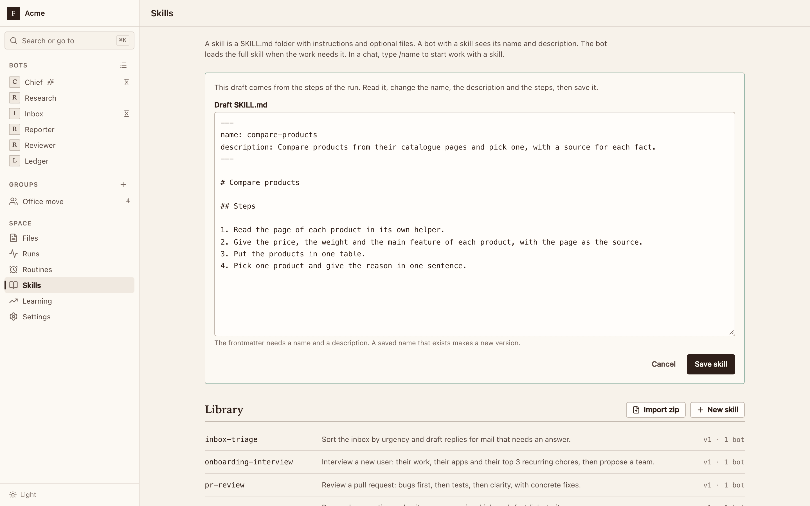

5. Under **Bots with this skill**, turn on the bots that use the skill. This example turns on Chief and Research.

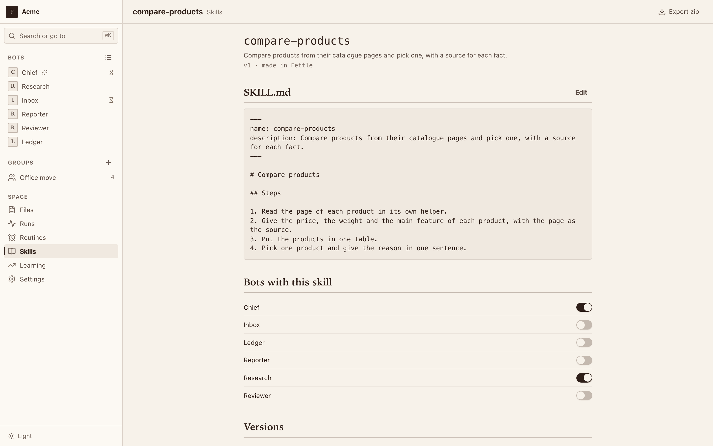

In a chat, type `/compare-products` to start work with the skill.
A save with a name that exists makes a new version of the skill. Read [skills.md](skills.md).

## 13. Turn on the weekly report

The template `weekly-report` gave Reporter the routine **Friday report**. The routine starts paused.

1. Select **Routines** in the sidebar.
2. Turn on the switch of **Friday report**. The row shows the time of the next run.
3. Select **Friday report** to open it.
4. Optional: select **Run now** to run it at once. **Last runs** lists each firing.

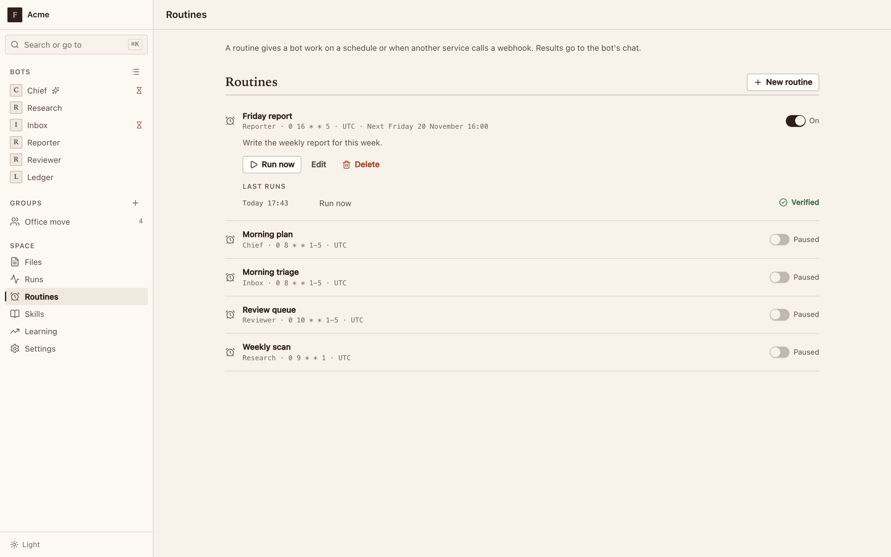

A routine sends its result to the chat of its bot.
No person starts the work of a routine, so each action outside the computer needs a card. Read [skills.md](skills.md#routines).

## 14. Examine runs, cost and Learning

1. Select **Runs** in the sidebar. The list shows each run with its state, its bot, its step, its time, its cost and its score.

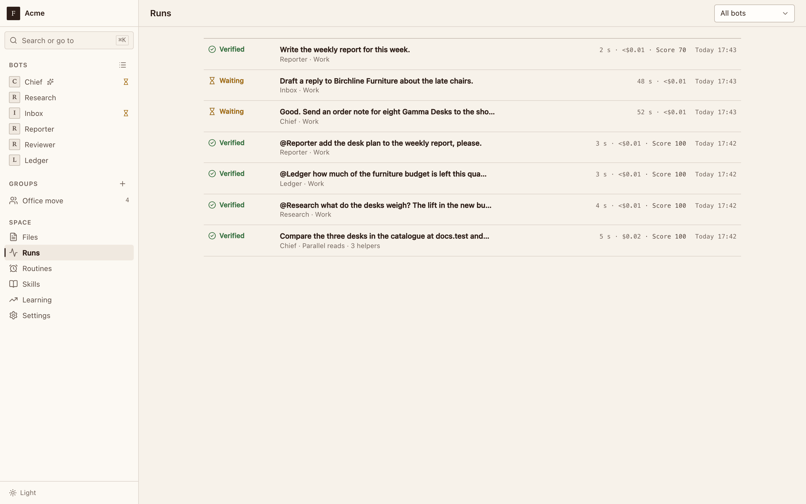

2. Select **Settings**, then **Cost**. Select **Bot** to group the cost by bot. Other groups are day, month, zone, run, step, role and model.
3. Select **Zone** to see the computer time of each zone. Computer time belongs to a zone, so the day, month and zone groups show it.

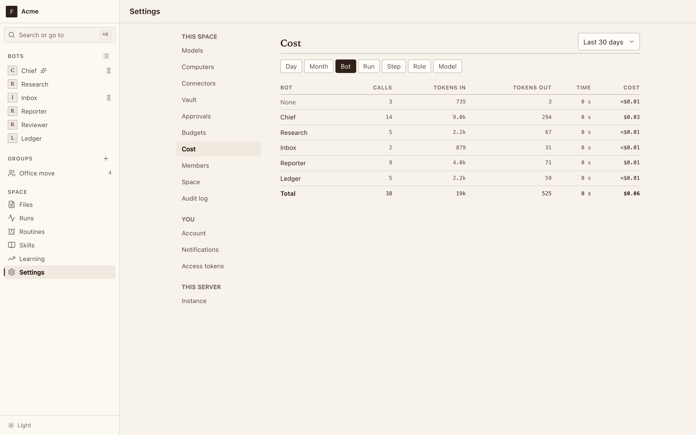

4. If a reply of a bot is wrong, react to it with a thumbs down. The reaction is a steering signal.
5. Select **Learning** in the sidebar.

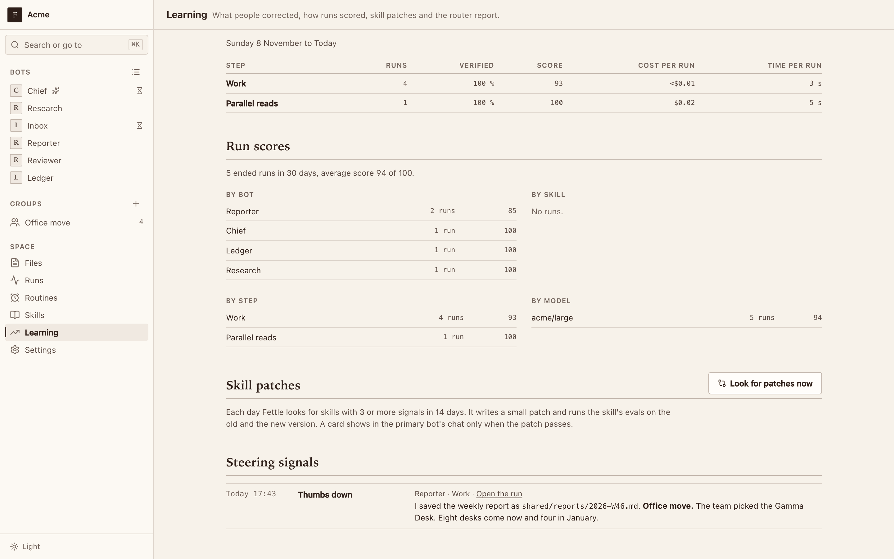

The **Router report** shows how each step did this week. The **Run scores** show the average score by bot, skill, step and model.
Each day Fettle looks for skills with 3 or more signals in 14 days. It writes a small patch and tests it with the evals of the skill.
A patch that passes becomes a card in the chat of Chief. The skill changes only after you allow the card.

## Next steps

- [Computers](computers.md): zones, sizes, providers and screens.
- [Models](models.md): providers, roles, fallback and budgets.
- [Connectors](connectors.md): give bots other apps through MCP.
- [Skills and routines](skills.md): skill files, evals, Skael sync and webhooks.
- [Security](security.md): approvals, rules, the vault and the journal.
- [Server](server.md): run Fettle for a team, with accounts and PostgreSQL.
- [Operations](operations.md): health, backups, upgrades and export of a space.
